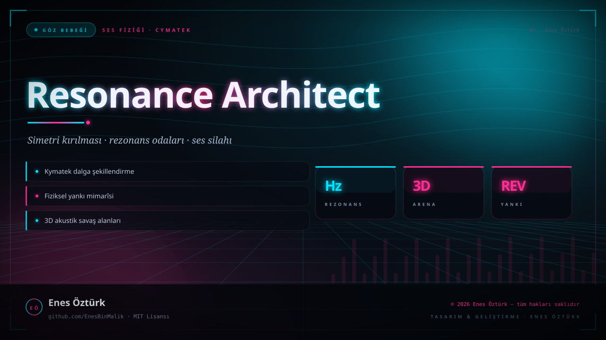
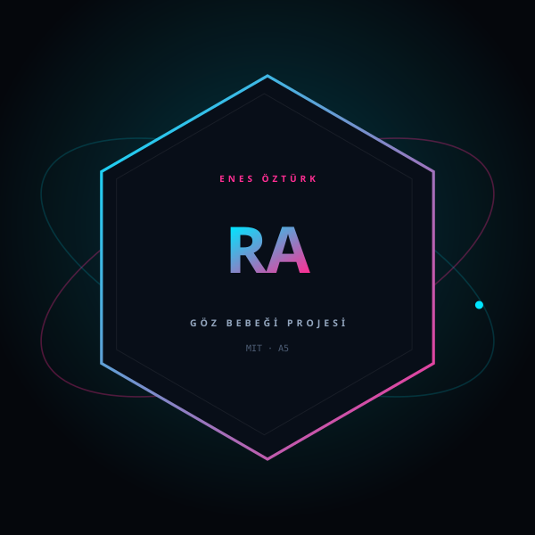

<div align="center">





# Resonance Architect: The Cymatic Abyss

**Kymatek dalgaların mimarı ol. Rezonansı silah, yankıyı zırh yap.**

[](https://github.com/EnesBinMalik)
[](LICENSE)
[](https://github.com/EnesBinMalik)

<sub>SES FİZİĞİ · CYMATEK · 3D AKSİYON</sub>

</div>

---

## Bu proje nedir?

Kymatek dalgaların mimarı ol. Rezonansı silah, yankıyı zırh yap.

**GÖZ BEBEĞİ** etiketiyle yayınlanmıştır: tasarımı, mimarîsi ve her satırı **Enes Öztürk** tarafından yazılmıştır.

## Öne çıkanlar

- **Kymatek dalga şekillendirme** — ses dalgası gerçek zamanlı olarak görünür hâle gelir; tepe ve çukurları fiziksel engel ya da silah olur.
- **Fiziksel yankı mimarîsi** — her arena, kendi yankılanma süresi ve frekans yanıtıyla modellenmiş akustik bir hacim.
- **Rezonans odaları** — doğru frekansı bul, odanın simetrisini kır, yapı çökmeden çık.
- **3D akustik savaş** — düşmanlar sesle çalışır; onları kendi frekansında boğarsın.

## Teknoloji

`Three.js` · `TypeScript` · `Web Audio API` · `Vite` · `Cymatics simulation` · `Navier-Stokes`

## Kurulum

```bash
npm install
npm run dev
```

## Lisans

**MIT Lisansı** — bkz. [LICENSE](LICENSE)

---

<div align="center">
<sub>© 2026 Enes Öztürk — tüm hakları saklıdır · <a href="https://github.com/EnesBinMalik">Dalgayı silah yap · github.com/EnesBinMalik</a></sub>
</div>
